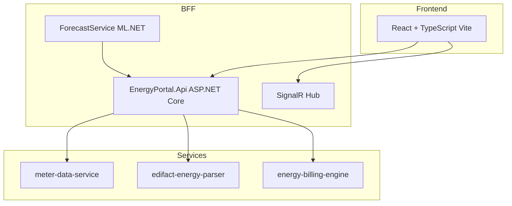

# energy-portal

> React + TypeScript frontend with an ASP.NET Core backend-for-frontend integrating all four portfolio services into one energy management portal.


---

## Problem

Energy suppliers and grid operators need a single interface to monitor consumption, manage contracts, review invoices, and handle market communication messages. Data lives across several backend services — meter readings, billing, EDIFACT messages — and must be presented coherently with live updates and actionable insights.

This portal connects the three backend services into a unified React frontend, adding a SignalR-powered live meter stream, an ML.NET consumption forecast with confidence bands, and a tariff advisor that compares fixed vs. dynamic pricing for each customer.

---

## Features

- Pages: customers & contracts, consumption charts (daily/monthly), load profile heat-map (day × hour), invoices with "explain my bill" tree, EDIFACT message inbox
- Live updates via SignalR (simulated smart meter stream)
- Consumption forecast with ML.NET SSA time series + confidence band
- CO₂ estimate per month using a synthetic grid emission factor
- Tariff advisor: fixed vs. dynamic tariff comparison via `energy-billing-engine`
- One `docker compose up` starts the full system (all services + databases + frontend)

---

## Innovation

_TODO: expand after implementation_

---

## Architecture



---

## Quick Start

```bash
docker compose up
```

Then open `http://localhost:3000`.

---

## Domain Glossary

| German | English | Explanation |
|--------|---------|-------------|
| Verbrauchsübersicht | Consumption overview | Dashboard showing energy use over time |
| Lastgangkurve | Load profile chart | Time-series visualization of 15-min interval values |
| Jahresübersicht | Annual overview | Monthly breakdown of consumption for a full year |
| CO₂-Emissionsfaktor | CO₂ emission factor | kgCO₂/kWh figure for the grid mix in a given period |
| Prognose | Forecast | Predicted future consumption based on historical patterns |

---

## Testing

```bash
# Backend
dotnet test

# Frontend
cd frontend && npm run type-check
```

---

## Design Decisions

See `docs/adr/` for Architecture Decision Records.

---

## Roadmap / Next Steps

- Accessibility audit (WCAG 2.1 AA)
- Dark mode
- Export consumption data as CSV

---

## Kurzfassung auf Deutsch

Das Energy Portal verbindet alle drei Backend-Services zu einer einheitlichen React-Oberfläche. Kunden und Verträge, Lastgangvisualisierungen, Rechnungen mit vollständigem Berechnungsbaum und ein EDIFACT-Posteingang sind auf dedizierten Seiten verfügbar. Ein SignalR-Hub liefert simulierte Echtzeit-Zählerdaten direkt in den Browser. Eine ML.NET-SSA-Zeitreihenprognose zeigt den voraussichtlichen Verbrauch der nächsten Tage mit Konfidenzband. Ein CO₂-Schätzer berechnet monatliche Emissionen auf Basis synthetischer Netzemissionsfaktoren. Der Tarifberater vergleicht Fest- und Dynamiktarif und zeigt das Einsparpotenzial je Kunde. Mit einem einzigen `docker compose up` starten alle Services, Datenbanken und das Frontend.
